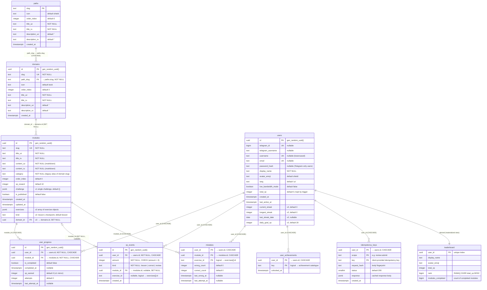

# CyberQalqon — Entity Relationship Diagram (ERD)

Full data model of the CyberQalqon backend (PostgreSQL).

> **Source of truth:** the schema is defined in code, in
> [`backend/setup.js`](backend/setup.js), which is idempotent and runs on every
> server boot (migrations + curriculum seed). This document is a faithful
> rendering of that file — if they ever diverge, `setup.js` wins.

> **Standalone version:** [`ERD.html`](ERD.html) is a self-contained, offline,
> dependency-free rendering of this diagram (schema map + full column specs).
> Open it directly in any browser — no internet or build step required.

- **Engine:** PostgreSQL (Render managed, free tier)
- **Extension:** `pgcrypto` (`gen_random_uuid()` for UUID primary keys)
- **Tables:** 9 · **Materialized view:** 1 · **Trigger:** 1
- **Bilingual pattern:** user-facing text is stored as `*_uz` / `*_ru` column pairs

---

## 1. Diagram



> `leaderboard` is a **materialized view** (read model), not a table — Mermaid
> has no view notation, so it is drawn like an entity with a derived 1:1 link
> from `users`.

---

## 2. Entity reference

### `paths`
A learning path — the top of the curriculum hierarchy. Primary key is the
human-readable `slug` (e.g. `cybersecurity`, `it-fundamentals`).

| Column | Type | Constraints / default | Notes |
|---|---|---|---|
| `slug` | `TEXT` | **PK** | e.g. `cybersecurity` |
| `icon` | `TEXT` | `NOT NULL`, default `🛡️` | emoji |
| `order_index` | `INTEGER` | `NOT NULL`, default `0` | display order |
| `title_uz` / `title_ru` | `TEXT` | `NOT NULL` | bilingual title |
| `description_uz` / `description_ru` | `TEXT` | `NOT NULL`, default `''` | bilingual blurb |
| `created_at` | `TIMESTAMPTZ` | `NOT NULL`, default `now()` | |

### `domains`
A knowledge domain belonging to exactly one path.

| Column | Type | Constraints / default | Notes |
|---|---|---|---|
| `id` | `UUID` | **PK**, default `gen_random_uuid()` | |
| `slug` | `TEXT` | **UNIQUE**, `NOT NULL` | e.g. `networking` |
| `path_slug` | `TEXT` | **FK → `paths.slug`**, `NOT NULL`, `ON DELETE CASCADE` | |
| `icon` | `TEXT` | `NOT NULL`, default `📘` | |
| `order_index` | `INTEGER` | `NOT NULL`, default `0` | order within path |
| `title_uz` / `title_ru` | `TEXT` | `NOT NULL` | |
| `description_uz` / `description_ru` | `TEXT` | `NOT NULL`, default `''` | |
| `created_at` | `TIMESTAMPTZ` | `NOT NULL`, default `now()` | |

### `modules`
A lesson (or checkpoint) — one unit of content plus its exercises.

| Column | Type | Constraints / default | Notes |
|---|---|---|---|
| `id` | `UUID` | **PK**, default `gen_random_uuid()` | |
| `slug` | `TEXT` | **UNIQUE**, `NOT NULL` | e.g. `cia-triad` |
| `title_uz` / `title_ru` | `TEXT` | `NOT NULL` | |
| `content_uz` / `content_ru` | `TEXT` | `NOT NULL` | markdown body |
| `category` | `TEXT` | `NOT NULL` | **legacy alias** — kept equal to the domain slug for rollback |
| `order_index` | `INTEGER` | `NOT NULL`, default `0` | order within domain |
| `xp_reward` | `INTEGER` | `NOT NULL`, default `10` | XP for first completion |
| `challenge` | `JSONB` | `NOT NULL`, default `'{}'` | **v1 single-challenge** payload (legacy) |
| `is_published` | `BOOLEAN` | `NOT NULL`, default `false` | seed sets `true` |
| `created_at` | `TIMESTAMPTZ` | `NOT NULL`, default `now()` | |
| `updated_at` | `TIMESTAMPTZ` | `NOT NULL`, default `now()` | |
| `exercises` | `JSONB` | nullable | **v2** — array of exercise objects (see §4) |
| `kind` | `TEXT` | `NOT NULL`, default `'lesson'` | **v2** — `lesson` \| `checkpoint` |
| `domain_id` | `UUID` | **FK → `domains.id`**, `ON DELETE SET NULL` | **v2** |

### `users`
Learner account. Supports both email/password and Telegram Web App auth, so
`telegram_id`, `username`, `email` and `password_hash` are all nullable —
identity can be established by either route.

| Column | Type | Constraints / default | Notes |
|---|---|---|---|
| `id` | `UUID` | **PK**, default `gen_random_uuid()` | |
| `telegram_id` | `BIGINT` | **UNIQUE**, nullable | Telegram Web App id |
| `telegram_username` | `TEXT` | nullable | |
| `username` | `TEXT` | **UNIQUE**, nullable | stored lowercased |
| `email` | `TEXT` | **UNIQUE**, nullable | stored lowercased |
| `password_hash` | `TEXT` | nullable | bcrypt (12 rounds) |
| `display_name` | `TEXT` | `NOT NULL` | |
| `avatar_emoji` | `TEXT` | default `🛡️` | |
| `lang` | `TEXT` | `NOT NULL`, default `'uz'` | `uz` \| `ru` in practice |
| `low_bandwidth_mode` | `BOOLEAN` | `NOT NULL`, default `false` | |
| `total_xp` | `INTEGER` | `NOT NULL`, default `0` | maintained by the `xp_events` trigger |
| `created_at` | `TIMESTAMPTZ` | `NOT NULL`, default `now()` | |
| `last_active_at` | `TIMESTAMPTZ` | `NOT NULL`, default `now()` | |
| `current_streak` | `INTEGER` | `NOT NULL`, default `0` | **v2** |
| `longest_streak` | `INTEGER` | `NOT NULL`, default `0` | **v2** |
| `last_streak_date` | `DATE` | nullable | **v2** — app timezone is `Asia/Tashkent` |
| `daily_goal_xp` | `INTEGER` | `NOT NULL`, default `20` | **v2** |

### `user_progress`
Per-user, per-module progress. One row per (user, module).

| Column | Type | Constraints / default | Notes |
|---|---|---|---|
| `id` | `UUID` | **PK**, default `gen_random_uuid()` | |
| `user_id` | `UUID` | **FK → `users.id`**, `NOT NULL`, `CASCADE` | |
| `module_id` | `UUID` | **FK → `modules.id`**, `NOT NULL`, `CASCADE` | |
| `is_completed` | `BOOLEAN` | `NOT NULL`, default `false` | |
| `completed_at` | `TIMESTAMPTZ` | nullable | |
| `xp_earned` | `INTEGER` | `NOT NULL`, default `0` | v1 mirror; `xp_events` is authoritative |
| `attempts` | `INTEGER` | `NOT NULL`, default `0` | |
| `last_attempt_at` | `TIMESTAMPTZ` | nullable | |
| — | — | **UNIQUE (`user_id`, `module_id`)** | |

### `xp_events`
Append-only XP ledger — **the single source of truth for XP** (post-v1). A DB
trigger rolls these up into `users.total_xp`.

| Column | Type | Constraints / default | Notes |
|---|---|---|---|
| `id` | `UUID` | **PK**, default `gen_random_uuid()` | |
| `user_id` | `UUID` | **FK → `users.id`**, `NOT NULL`, `CASCADE` | |
| `amount` | `INTEGER` | `NOT NULL`, **CHECK (`amount > 0`)** | |
| `kind` | `TEXT` | `NOT NULL` | `lesson` \| `correct` \| `review` |
| `module_id` | `UUID` | **FK → `modules.id`**, nullable, `SET NULL` | |
| `exercise_id` | `TEXT` | nullable | logical ref into `modules.exercises[].id` |
| `created_at` | `TIMESTAMPTZ` | `NOT NULL`, default `now()` | |

XP cadence (from `backend/lib/gamification.js`): `lesson` = module `xp_reward`,
`correct` = **+3**, `review` = **+4** capped at **30/day**.

### `mistakes`
Per-exercise weakness tracker that drives `/practice` review sessions.

| Column | Type | Constraints / default | Notes |
|---|---|---|---|
| `user_id` | `UUID` | **PK**/**FK → `users.id`**, `CASCADE` | |
| `module_id` | `UUID` | **PK**/**FK → `modules.id`**, `CASCADE` | |
| `exercise_id` | `TEXT` | **PK** | logical ref into `modules.exercises[].id` |
| `wrong_count` | `INTEGER` | `NOT NULL`, default `0` | |
| `correct_count` | `INTEGER` | `NOT NULL`, default `0` | |
| `last_wrong_at` | `TIMESTAMPTZ` | nullable | |
| `last_attempt_at` | `TIMESTAMPTZ` | nullable | |
| — | — | **PK (`user_id`, `module_id`, `exercise_id`)** | |

### `user_achievements`
Unlocked achievement badges. One row per (user, achievement key).

| Column | Type | Constraints / default | Notes |
|---|---|---|---|
| `user_id` | `UUID` | **PK**/**FK → `users.id`**, `CASCADE` | |
| `key` | `TEXT` | **PK** | logical ref to the code catalogue (see §4) |
| `unlocked_at` | `TIMESTAMPTZ` | `NOT NULL`, default `now()` | |
| — | — | **PK (`user_id`, `key`)** | |

### `idempotency_keys`
Duplicate-safe mutation guard: at most one side effect per
`(user, scope, key)`. The PK is the uniqueness guarantee; `runIdempotent`
also takes an advisory lock on the same tuple so concurrent duplicates
serialise instead of racing. Rows older than 7 days are pruned on boot.

| Column | Type | Constraints / default | Notes |
|---|---|---|---|
| `user_id` | `UUID` | **PK**/**FK → `users.id`**, `CASCADE` | |
| `scope` | `TEXT` | **PK** | operation id, currently `review.submit` |
| `key` | `TEXT` | **PK** | client-supplied idempotency key |
| `request_hash` | `TEXT` | `NOT NULL` | request-body fingerprint |
| `status` | `SMALLINT` | `NOT NULL`, default `200` | cached HTTP status |
| `response` | `JSONB` | `NOT NULL`, default `'{}'` | cached response body |
| `created_at` | `TIMESTAMPTZ` | `NOT NULL`, default `now()` | |
| — | — | **PK (`user_id`, `scope`, `key`)** | |

### `leaderboard` (materialized view — read model)
Denormalized leaderboard built from `users` + `user_progress`.

| Column | Derivation |
|---|---|
| `user_id` | `users.id` |
| `display_name` | `users.display_name` |
| `avatar_emoji` | `users.avatar_emoji` |
| `total_xp` | `users.total_xp` |
| `rank` | `RANK() OVER (ORDER BY users.total_xp DESC)` |
| `modules_completed` | `COUNT(user_progress.module_id) FILTER (WHERE is_completed)` |

---

## 3. Relationships

| Parent | Child | Column | On delete | Cardinality |
|---|---|---|---|---|
| `paths` | `domains` | `domains.path_slug → paths.slug` | `CASCADE` | 1 path → many domains |
| `domains` | `modules` | `modules.domain_id → domains.id` | `SET NULL` | 1 domain → many modules |
| `users` | `user_progress` | `user_progress.user_id` | `CASCADE` | 1 user → many progress rows |
| `modules` | `user_progress` | `user_progress.module_id` | `CASCADE` | 1 module → many progress rows |
| `users` | `xp_events` | `xp_events.user_id` | `CASCADE` | 1 user → many XP events |
| `modules` | `xp_events` | `xp_events.module_id` | `SET NULL` | 0..1 module per event (nullable) |
| `users` | `mistakes` | `mistakes.user_id` | `CASCADE` | 1 user → many mistake rows |
| `modules` | `mistakes` | `mistakes.module_id` | `CASCADE` | 1 module → many mistake rows |
| `users` | `user_achievements` | `user_achievements.user_id` | `CASCADE` | 1 user → many unlocks |
| `users` | `idempotency_keys` | `idempotency_keys.user_id` | `CASCADE` | 1 user → many keys |
| `users` + `user_progress` | `leaderboard` | derived | n/a (view) | 1 user → 1 leaderboard row |

**Every FK that references `modules` uses `SET NULL` only for `xp_events`**
(so the ledger survives module deletion), while progress/mistakes use
`CASCADE`.

---

## 4. Enumerations & logical (non-enforced) references

These are the join-like links PostgreSQL does **not** enforce — they live in
application code.

| Field | Domain values | Defined in |
|---|---|---|
| `modules.kind` | `lesson`, `checkpoint` | curriculum files |
| `xp_events.kind` | `lesson`, `correct`, `review` | `backend/lib/gamification.js` |
| `idempotency_keys.scope` | `review.submit` | `backend/routes/review.js` |
| `xp_events.exercise_id`, `mistakes.exercise_id` | id of an object inside `modules.exercises[]` (JSON) | `backend/lib/grade.js` |
| `user_achievements.key` | 12 keys: `first_lesson`, `five_lessons`, `ten_lessons`, `perfect_lesson`, `streak_7`, `xp_500`, `xp_2000`, `reviewer`, `checkpoint`, `network_explorer`, `linux_penguin`, `web_defender` | `backend/lib/gamification.js` |
| `users.lang` | `uz`, `ru` (UI ships these) | `frontend/src/lib/i18n.ts` |

`modules.exercises` element shape (grading contract):

```jsonc
{
  "id": "e1",
  "type": "mc | multi | tf | match | order | input",
  "q": { "uz": "...", "ru": "..." },
  "options": [{ "id": "a", "uz": "...", "ru": "..." }],
  "answer": "...",            // stripped by publicExercise()
  "answers": ["..."],         // multi
  "order": ["..."],           // order
  "match_answer": { "p1": "p1" }, // match: pair id → pair id
  "explain": { "uz": "...", "ru": "..." }
}
```

---

## 5. Triggers, view refresh, indexes

**Trigger — `users.total_xp` sync**

```
xp_events (AFTER INSERT)
  └─ sync_user_xp()  →  UPDATE users
                          SET total_xp = SUM(xp_events.amount),
                              last_active_at = now()
                        WHERE id = NEW.user_id
```

`trg_sync_user_xp` is dropped and recreated on every boot (fires on
`xp_events` only, `FOR EACH ROW`). `total_xp` is therefore a **derived cache**
of the ledger.

**Indexes**

| Index | Table | Columns |
|---|---|---|
| `idx_xp_events_user` | `xp_events` | (`user_id`, `created_at DESC`) |
| `idx_xp_events_time` | `xp_events` | (`created_at DESC`) |
| `idx_mistakes_user` | `mistakes` | (`user_id`) |
| `idx_idempotency_created` | `idempotency_keys` | (`created_at`) |
| `idx_leaderboard_user_id` | `leaderboard` | (`user_id`) — **UNIQUE** |
| `idx_leaderboard_rank` | `leaderboard` | (`rank`) |

---

## 6. Legacy / backward-compatibility notes

The schema evolved from a v1 and keeps compatibility shims:

- **`modules.category`** — v1 free-text category, now kept in sync with the
  domain slug and used as a rollback alias.
- **`modules.challenge`** — v1 single-challenge JSONB, superseded by
  `modules.exercises[]`. A backfill converts any `challenge`-only module into a
  one-element `exercises` array.
- **`user_progress.xp_earned`** — v1 XP bookkeeping; a one-time backfill imports
  it into `xp_events` (`kind = 'lesson'`) and recomputes `total_xp`.
- **Legacy backfill** — modules with no `domain_id` get an auto-created domain
  from their `category`, so nothing is orphaned.

---

## 7. Not in the database

- **Hearts** — 5 max, one lost per wrong answer, refilled daily. Stored
  **client-side** in `localStorage` (`cq_hearts`, see
  `frontend/src/lib/hearts.ts`), never in Postgres. Hearts never hard-block
  learning.
- **Review scheduling** — derived from the `mistakes` table on demand (not a
  separate queue table).
- **Auth tokens** — stateless 30-day JWTs; no session/token table.

---

## 8. Quick counts

| Thing | Count |
|---|---|
| Tables | 9 |
| Materialized views | 1 (`leaderboard`) |
| Triggers | 1 (`trg_sync_user_xp`) |
| Foreign keys (enforced) | 10 |
| Composite primary keys | 3 (`mistakes`, `user_achievements`, `idempotency_keys`) |
| Logical (unenforced) references | 3 (`exercise_id` ×2, `user_achievements.key`) |
